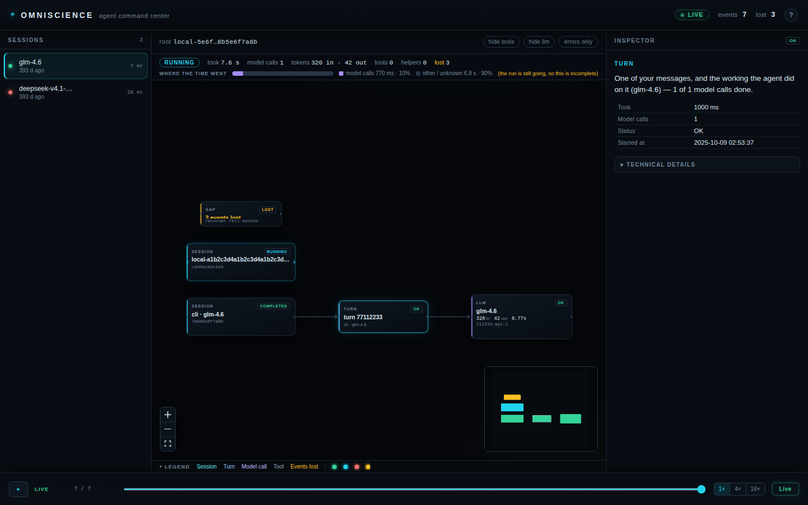

<p align="center">
  
</p>

<h1 align="center">Omniscience</h1>

<p align="center"><em>See what your Hermes agent is doing, live. Every step on a map, with replay. Local, private, read-only.</em></p>

<p align="center">
  <a href="https://github.com/KeyArgo/hermes-omniscience/releases/latest"></a>
  
  
  
  
  
  <a href="https://github.com/KeyArgo/hermes-omniscience/stargazers"></a>
</p>

<p align="center">
  
  <br/><sub>A live run: sessions, turns, model calls, tools and subagents, all on one canvas.</sub>
</p>

## What it is

Omniscience records what your Hermes agent does, as it happens, and draws it as a graph you can read at a glance. You watch a long run in real time instead of scrolling a log, and you can replay it step by step afterwards.

## Why it is different

The graph is live and the replay is deterministic. Other tools import a finished trace or report on cost after the fact. Omniscience maps the run as it unfolds, session to turns to model calls to tools to subagents, then lets you scrub back through that same graph and land on the exact step where something went wrong. It stores metadata only: names, timings, sizes and statuses, never prompts, arguments or outputs.

## Try it in five minutes

No Hermes needed. This runs the viewer against generated demo data.

Linux and macOS:

```bash
git clone https://github.com/KeyArgo/hermes-omniscience
cd hermes-omniscience
python3 -m venv .venv && . .venv/bin/activate
pip install -r requirements-dev.txt
cd web && npm ci && npm run build && cd ..
python demo/synth.py demo.db
PYTHONPATH=viewer python -m omniscience_viewer --db demo.db
```

Windows PowerShell:

```powershell
git clone https://github.com/KeyArgo/hermes-omniscience
cd hermes-omniscience
python -m venv .venv; .\.venv\Scripts\Activate.ps1
pip install -r requirements-dev.txt
cd web; npm ci; npm run build; cd ..
python demo/synth.py demo.db
$env:PYTHONPATH = "viewer"; python -m omniscience_viewer --db demo.db
```

Open <http://127.0.0.1:8797>.

To run it against a real Hermes:

```bash
hermes plugins install KeyArgo/hermes-omniscience --enable
```

Then restart the Hermes gateway once so it loads. Omniscience never restarts it for you. The plugin starts its viewer on 127.0.0.1:8797 the first time it loads, answering this computer only, behind a per-launch key that `/omni` and the desktop page pass along for you.

## What to click

- The run summary sentence at the top.
- **Where the time went**, largest spans first.
- A folded box such as "12 model calls · 9 tools", to open a busy message.
- **Things worth a look**, for a tool repeated many times or a request that stopped without an answer.
- **Next error**, to jump straight to the failed step.

What good looks like: a **Live** or **Recorded** badge in the header, a summary that reads like a sentence, and a graph that is never blank while a run has events.

## Privacy

Omniscience keeps metadata only: names, timings, sizes and statuses. It does not store prompts, commands, arguments or outputs. The few short free-text fields it keeps, such as an error reason, are truncated and run through pattern-based redaction for keys, tokens, passwords in URLs, email addresses and JWTs. Pattern matching can miss an unusual secret, so do not rely on it as your only protection. The viewer binds to loopback with no write endpoints.

- Full detail: [docs/SECURITY.md](docs/SECURITY.md)
- What it can and cannot see: [docs/COVERAGE.md](docs/COVERAGE.md)

## It never blocks your agent

The hook copies metadata onto a bounded queue of 10,000 events. A background thread writes batches to SQLite. If the queue is full, the database is locked, or the disk is full, events are dropped and counted rather than slowing the agent. If the viewer is down, the agent does not notice.

## Limits

- It records Hermes sessions only. A different harness would need its own recorder writing the same schema.
- Events can be dropped under heavy load. When the queue overflows the writer records a dropped marker, so loss is visible rather than hidden.
- The viewer is read-only and loopback only by design. There is no remote access mode.

The full list is in [LIMITS.md](LIMITS.md).

## Tests

```bash
PYTHONPATH=viewer:viewer_app:. pytest -o addopts="" -q tests     # 736 passed (measured 2026-11-10)
cd web && npm test                                 # front-end suite
```

Row by row, with the command and the real output for each claim, in [VERIFY.md](VERIFY.md).

## Platform support

| Platform | Status |
|---|---|
| Linux | verified in CI |
| macOS | verified in CI |
| Windows | verified in CI |

## How it works

```
Hermes observer hooks
        |
        v
plugin (repo root)  -->  events.db (SQLite, local, mode 0600)
                              |  read-only
                              v
                     viewer (127.0.0.1:8797)
                              |
                              v
                          browser
```

More detail in [docs/ARCHITECTURE.md](docs/ARCHITECTURE.md). Install, viewer flags and uninstall: [docs/INSTALL.md](docs/INSTALL.md). Common questions: [docs/FAQ.md](docs/FAQ.md).

## How it compares

| Project | What it does | Where Omniscience differs |
|---|---|---|
| agent-run-debugger | Imports one trace, gives a timeline, failure points and an inert replay | Omniscience is live and shows an execution graph; replay rewinds that graph |
| olympus | Dashboard of every agent and profile, live run list, anomaly flags | Olympus is a fleet list; Omniscience is a per-run topology map |
| session-lens | Per-session cost, full trace, recurring failures, model comparison | Session-lens is desktop reporting; Omniscience is a live graph and scrubber |
| hermes-telemetry | Tokens, cost and latency into local SQLite, with commands | Metrics only, no graph interface |
| langfuse, OTel exporters | Send traces to a Langfuse or OTLP backend | Omniscience needs no server; export is optional |

These tools overlap on parts of observability. The distinct piece here is the live session to turns to model calls to tools to subagents graph with deterministic, scrubbable replay. If you already run Langfuse or need fleet-wide dashboards, keep them.

---

<p align="center">
  
  <br/>
  <sub>Built by <strong>InovinLabs</strong>. MIT licensed.</sub>
  <br/>
  <sub>Sibling tools:
  <a href="https://github.com/inovinlabs/hermes-gameshelf">Game Center</a> ·
  <a href="https://github.com/inovinlabs/hermes-music-studio">Music Studio</a> ·
  <a href="https://github.com/inovinlabs/hermes-movie-studio">Movie Studio</a> ·
  <a href="https://github.com/inovinlabs/hermes-aura">Aura</a> ·
  <a href="https://github.com/inovinlabs/hermes-hail">Hail</a> ·
  <a href="https://github.com/inovinlabs/hermes-design-studio">Design Studio</a> ·
  <a href="https://github.com/inovinlabs/hermes-antisloop">Anti-Slop</a></sub>
</p>
