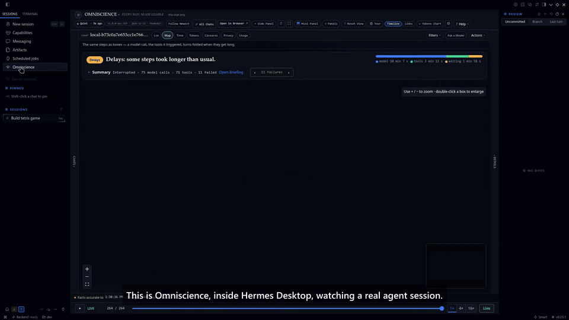
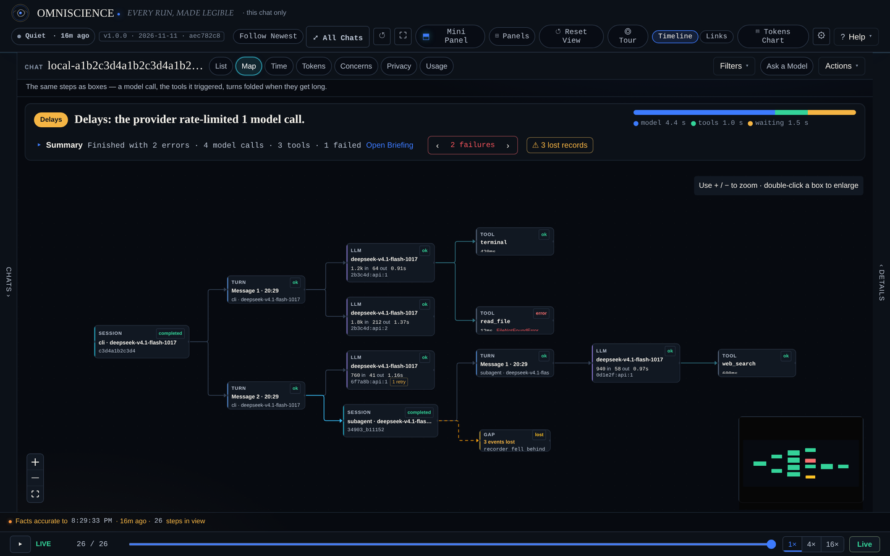
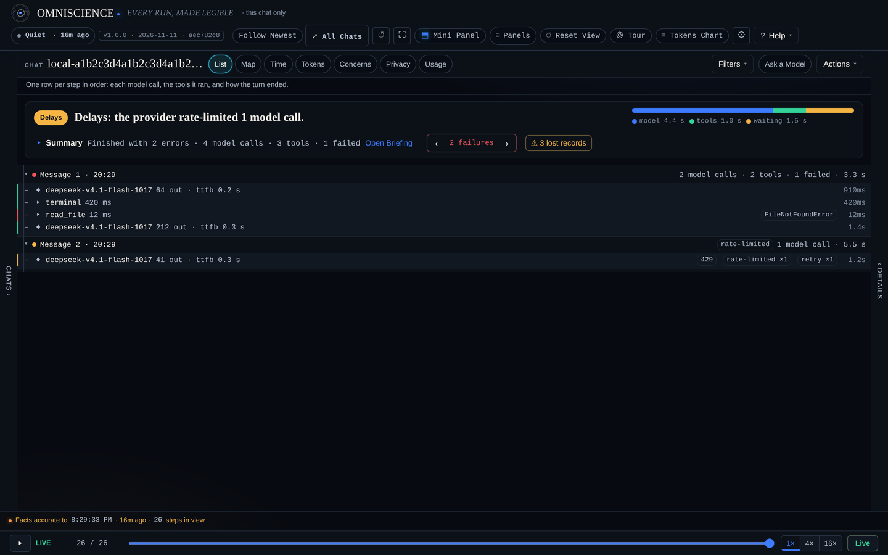
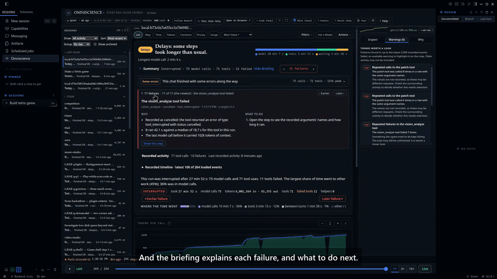
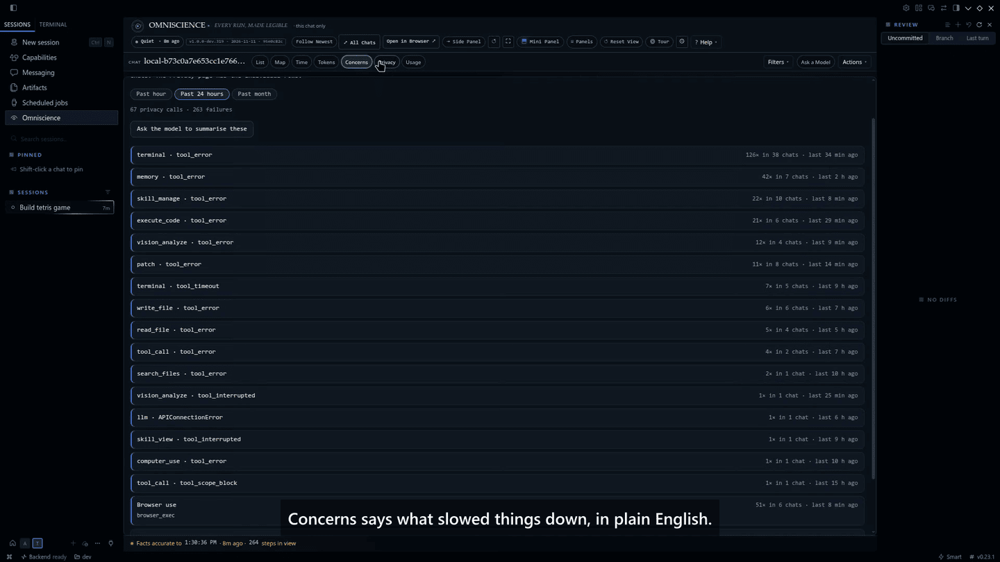
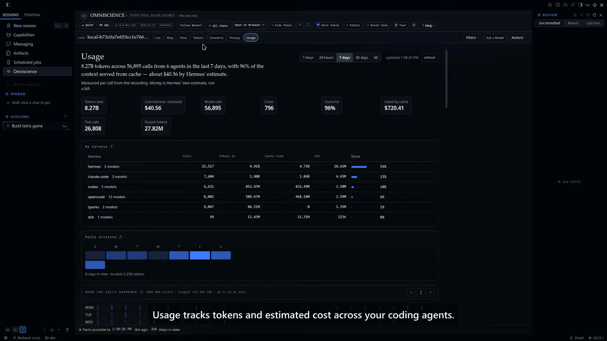
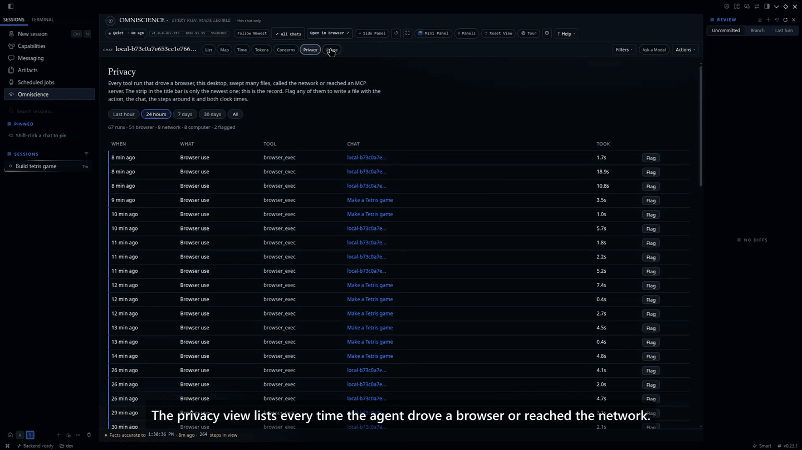
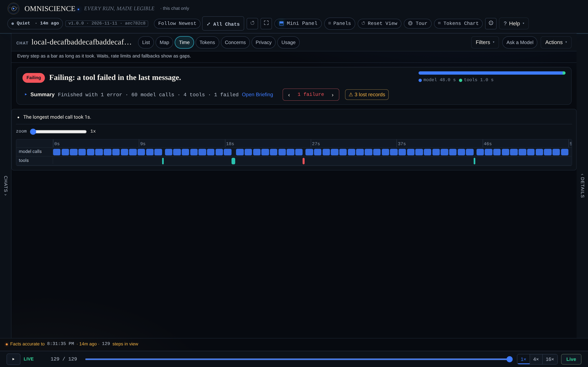
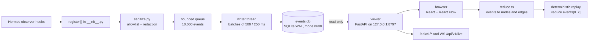

<p align="center">
  
</p>

<h1 align="center">Omniscience</h1>

<p align="center"><em>See what your Hermes agent is doing, live. Every step on a map, with replay. Local, private, read-only.</em></p>

<p align="center">
  <a href="https://github.com/KeyArgo/hermes-omniscience/actions/workflows/tests.yml"></a>
  <a href="TESTING.md"></a>
  <a href="https://github.com/KeyArgo/hermes-omniscience/releases/latest"></a>
  <a href="LICENSE"></a>
  <a href="https://github.com/NousResearch/hermes-agent"></a>
  
  
  <a href="https://github.com/KeyArgo/hermes-omniscience/stargazers"></a>
</p>

<p align="center">
  
  <br/><sub><b>Omniscience inside Hermes Desktop</b>, watching a real agent session. <a href="https://x.com/MHArgonaut/status/2120633813705363663">Watch the full demo ▶</a></sub>
</p>

<p align="center">
  <a href="#install">Install</a> ·
  <a href="#features">Features</a> ·
  <a href="#how-it-works">How it works</a> ·
  <a href="#documentation">Documentation</a> ·
  <a href="#testing">Testing</a> ·
  <a href="#contributing">Contributing</a>
</p>

## What it is

Omniscience is a Hermes Agent plugin that records what the agent does, as it happens, and draws it as a graph you can read at a glance. Sessions, turns, model calls, tool calls, helper agents and lost-event gaps all sit on one canvas. You watch a long run live instead of scrolling a log, then scrub back through the same graph to the step where something went wrong.

## Why it's different

The graph is live and the replay is deterministic. Other tools import a finished trace or report on cost after the fact. Omniscience maps the run as it unfolds, then lets you rewind that same graph, step by step, with the same layout every time. It stores metadata only: names, timings, sizes and statuses, never prompts, arguments or outputs.

## Features

- **Live execution graph.** Sessions, turns, model requests, tools, helper agents and `GAP` markers for lost events, updated from the recorder's SQLite file over a local WebSocket.
- **Deterministic replay.** Drag the replay bar to any step and the graph is rebuilt from the rows up to that point. Nothing is re-run.
- **Fold busy turns.** A long turn folds into one box such as "60 model calls · 4 tools"; open it when you need the detail.
- **Plain-English triage.** A verdict line, "Where the time went", **Things worth a look**, a failure stepper, and explanations built only from recorded fields.
- **Five main views** — List, Map, Time, Tokens, Usage — plus Flame, Tools, Context, Helpers, Coverage, Latency, Concerns and Privacy.
- **Usage page.** Tokens per call, cache share, model and provider tables, compactions and Hermes' own cost estimate, clearly labelled as an estimate. `/omni tokens` prints the short version in chat.
- **In-chat turn summary.** A short digest at the end of each turn, on by default, with `brief`, `standard` and `full` detail levels.
- **`/omni` command.** Triage the current chat, show usage, pause recording for this chat (`/omni off`), resume it, or delete its recording (`/omni forget confirm`).
- **Privacy controls.** Recording can be paused per chat; the viewer has a privacy page and can flag a sensitive tool run into a standalone dossier.
- **Export and bundles.** CSV exports of steps, chats and models; a redacted JSON problem bundle you can preview before writing.
- **Local by default.** The viewer binds `127.0.0.1`, opens the database read-only, and uses a per-launch key. No cloud service, no telemetry endpoint.
- **Never blocks the agent.** Hooks copy metadata onto a bounded queue of 10,000 events; a background thread writes batches to SQLite. Drops are counted, not hidden.
- **Hermes dashboard tab.** `dashboard/` mounts the same live view inside the Hermes dashboard when the plugin is enabled.
- **History import.** Chats that ran before the plugin was enabled are imported from Hermes' own state database, metadata only.

## Screenshots

<table>
  <tr>
    <td width="50%" align="center">
      
      <br/><sub><b>Map.</b> The execution graph, with helper agents nested under the turn that started them.</sub>
    </td>
    <td width="50%" align="center">
      
      <br/><sub><b>List.</b> One row per step in order, with durations, token counts and error types.</sub>
    </td>
  </tr>
  <tr>
    <td width="50%" align="center"><br/><sub><b>Briefing.</b> Each failure in plain English, and what to do next.</sub></td>
    <td width="50%" align="center"><br/><sub><b>Concerns.</b> What slowed things down, in plain English.</sub></td>
  </tr>
  <tr>
    <td width="50%" align="center"><br/><sub><b>Usage.</b> Tokens, cache share and Hermes' cost estimate across your agents.</sub></td>
    <td width="50%" align="center"><br/><sub><b>Privacy.</b> Every time the agent drove a browser or reached the network.</sub></td>
  </tr>
  <tr>
    <td colspan="2" align="center">
      
      <br/><sub><b>Time.</b> Every step as a bar as long as it took; waits and gaps stay visible.</sub>
    </td>
  </tr>
</table>

## Install

```bash
hermes plugins install KeyArgo/hermes-omniscience --yes-deps --enable
```

Then restart the Hermes gateway once so it loads the plugin. Omniscience never restarts it for you.

Requirements:

- Hermes Agent **v0.23.0 or newer** (`requires_hermes: ">=0.23.0"` in `plugin.yaml`).
- FastAPI and uvicorn for the bundled viewer; Hermes already ships both.
- A WebSocket library (`websockets` or `uvicorn[standard]`) for the live feed; the top bar shows **OFFLINE** without one.
- Node and npm only if you want to rebuild the web UI from `web/`.

The plugin starts its viewer on `127.0.0.1:8797` the first time it loads, answering this computer only, behind a per-launch key that `/omni` and the dashboard page pass along for you. Recording continues even when the viewer is down.

## Quick start

No Hermes needed. This serves the bundled viewer against generated demo data.

```bash
git clone https://github.com/KeyArgo/hermes-omniscience
cd hermes-omniscience
python3 -m venv .venv && . .venv/bin/activate
pip install -r requirements-dev.txt
PYTHONPATH=viewer_app python3 -m omniscience_viewer --demo
```

Open <http://127.0.0.1:8797>. `--demo` writes a temporary events database and does not touch `~/.hermes`.

To run the viewer against a real Hermes recording instead, omit `--demo`; it reads
`$HERMES_HOME/plugin-data/omniscience/events.db` (normally `~/.hermes/plugin-data/omniscience/events.db`).
More launch flags and the Windows steps are in [docs/INSTALL.md](docs/INSTALL.md).

## How it works



The plugin runs inside Hermes and does no network work on the hook path. Each callback copies a small allowlisted set of fields and pushes an event onto a bounded queue; a daemon thread writes batches to a local SQLite database. The viewer is a separate process that opens that database read-only and serves the React UI plus a REST and WebSocket API. The browser reduces the event rows into nodes and edges with a pure function, so replay at step *k* is just the same reduction over the first *k* rows. Lost events appear as `GAP` markers rather than disappearing.

Named modules: `__init__.py`, `sanitize.py`, `store.py`, `schema.py` for recording; `viewer/omniscience_viewer/app.py` and `db.py` for the API; `web/src/graph/reduce.ts` for the graph; `demo/synth.py` for demo data. The full picture, including the event contract and on-disk locations, is in [docs/ARCHITECTURE.md](docs/ARCHITECTURE.md).

## Documentation

| Document | What it covers |
|---|---|
| [docs/README.md](docs/README.md) | Index of every guide in `docs/` |
| [docs/ARCHITECTURE.md](docs/ARCHITECTURE.md) | Components, data flow, event contract, on-disk data |
| [docs/INSTALL.md](docs/INSTALL.md) | Install, upgrade, uninstall, viewer flags |
| [docs/CONFIGURATION.md](docs/CONFIGURATION.md) | Every environment variable and stored setting |
| [docs/DEVELOPMENT.md](docs/DEVELOPMENT.md) | Repository layout, suites, CI and documentation stamps |
| [docs/USAGE.md](docs/USAGE.md) | A walkthrough of the viewer and the `/omni` command |
| [docs/REFERENCE.md](docs/REFERENCE.md) | Hooks, events, HTTP routes, CLI, rules and config keys |
| [docs/TROUBLESHOOTING.md](docs/TROUBLESHOOTING.md) | Real failure modes and what to do |
| [docs/USER-GUIDE.md](docs/USER-GUIDE.md) | How to read the viewer in depth |
| [docs/UI-GUIDE.md](docs/UI-GUIDE.md) | A guide to every control on the screen |
| [docs/FAQ.md](docs/FAQ.md) | Short answers to the first questions |
| [docs/COVERAGE.md](docs/COVERAGE.md) | Which Hermes hooks are recorded, and which are not |
| [docs/HERMES_INTEGRATION.md](docs/HERMES_INTEGRATION.md) | Verified hook payloads and Hermes version compatibility |
| [docs/SECURITY.md](docs/SECURITY.md) | Threat model, collection policy, what leaves the machine |
| [docs/SECURITY-AUDIT.md](docs/SECURITY-AUDIT.md) | A module-by-module security audit |
| [docs/DECISIONS.md](docs/DECISIONS.md) | Design decisions and their reasoning |
| [docs/ROADMAP.md](docs/ROADMAP.md) | What is built, what is next, what is parked |
| [docs/DEMO.md](docs/DEMO.md) | A 90-second demo script |
| [docs/VERSIONING.md](docs/VERSIONING.md) | Version scheme and the documentation currency rule |
| [docs/BUG-LOG.md](docs/BUG-LOG.md) | Known defects and examined non-defects |
| [docs/DOC-INDEX.md](docs/DOC-INDEX.md) | Generated index with the build stamp of each guide |
| [docs/dev/PERFORMANCE_TUNING.md](docs/dev/PERFORMANCE_TUNING.md) | Performance work and measured results |
| [docs/dev/PREVENT_POLLING_REGRESSION.md](docs/dev/PREVENT_POLLING_REGRESSION.md) | The polling-interval guard and why it exists |
| [docs/dev/REGRESSION_TESTING.md](docs/dev/REGRESSION_TESTING.md) | Regression and performance requirements |
| [TESTING.md](TESTING.md) | How to run each suite, counts, and what CI runs |
| [VERIFY.md](VERIFY.md) | A short install verification |
| [LIMITS.md](LIMITS.md) | What the plugin deliberately does not do |
| [CHANGELOG.md](CHANGELOG.md) | Release history |
| [CONTRIBUTING.md](CONTRIBUTING.md) | Dev setup, tests, commit style, PR flow |
| [CODE_OF_CONDUCT.md](CODE_OF_CONDUCT.md) | Contributor Covenant 2.1 |
| [SECURITY.md](SECURITY.md) | How to report a vulnerability privately |
| [THIRD-PARTY.md](THIRD-PARTY.md) | Third-party projects this repo uses |

## Privacy & security

- **Stored:** IDs, timestamps, durations, model and provider names, token counts, statuses, error types, tool names, argument names and character counts.
- **Not stored:** prompts, conversation history, assistant text, tool argument values, tool results, request or response bodies, headers, environment values, credentials. Error messages are kept only as a length.
- **Free text that is kept** (such as an error reason) is truncated and passed through pattern-based redaction. Pattern matching can miss an unusual secret, so it is not the only protection you should rely on.
- **Network calls:** the recorder makes none. The viewer serves loopback only. Two opt-in features can reach the network: **Ask a Model** sends a metadata-only digest to a provider you pick, using credentials Hermes already has, and the optional **DGX Sparks** usage source polls TensorFold counters you configure in `OMNISCIENCE_TENSORFOLD_HOSTS`. Neither runs unless you turn it on.
- **Background processes:** the plugin may autostart the viewer (`OMNISCIENCE_VIEWER_AUTOSTART=1` by default), and may import earlier chat metadata from Hermes' `state.db` once (metadata only).
- **Shell commands:** the plugin launches the viewer with the current Python interpreter. The optional brake is an operator-run shell script, `scripts/brake.sh`, which changes Hermes' own run-API settings; Omniscience never runs it for you.
- **Data location:** `$HERMES_HOME/plugin-data/omniscience/`. Deleting that folder deletes every event it recorded.

Full detail: [docs/SECURITY.md](docs/SECURITY.md) and [docs/COVERAGE.md](docs/COVERAGE.md). Report vulnerabilities through GitHub's private advisory form, as described in [SECURITY.md](SECURITY.md).

## Testing

```bash
PYTHONPATH=viewer python3 -m pytest tests -q -p no:cacheprovider   # Python
cd web && npm test                                                  # front end
```

| Suite | Command | Result (measured 2026-11-11) |
|---|---|---|
| Python (plugin, viewer, contract, e2e, QA) | `PYTHONPATH=viewer python3 -m pytest tests -q -p no:cacheprovider` | **805 passed** |
| Front end (vitest) | `cd web && npm test` | **595 passed** |
| Total | | **1400 passed** |

CI (`.github/workflows/tests.yml`) runs the Python suite on Ubuntu, macOS and Windows, for Python 3.11 and 3.12, with `PYTHONPATH=viewer`. The counts above were measured locally on Linux with Python 3.13; the macOS and Windows jobs are the CI evidence for those platforms. Two extra guard workflows check the viewer's polling interval. Details and the exact output are in [TESTING.md](TESTING.md).

## Limits

- It records Hermes sessions only. A different harness would need its own recorder writing the same schema.
- Tool starts are not seen, only tool ends, so a tool that hangs forever does not appear until it finishes.
- Events can be dropped under heavy load. The writer keeps a `GAP` marker so loss is visible rather than hidden.
- The viewer is read-only and loopback only by design. There is no remote access mode.

The full list is in [LIMITS.md](LIMITS.md).

## How it compares

| Project | What it does | Where Omniscience differs |
|---|---|---|
| agent-run-debugger | Imports one trace, gives a timeline, failure points and an inert replay | Omniscience is live and shows an execution graph; replay rewinds that graph |
| olympus | Dashboard of every agent and profile, live run list, anomaly flags | Olympus is a fleet list; Omniscience is a per-run topology map |
| session-lens | Per-session cost, full trace, recurring failures, model comparison | Session-lens is desktop reporting; Omniscience is a live graph and scrubber |
| hermes-telemetry | Tokens, cost and latency into local SQLite, with commands | Metrics only, no graph interface |
| langfuse, OTel exporters | Send traces to a Langfuse or OTLP backend | Omniscience needs no server; export is optional |

These tools overlap on parts of observability. The distinct piece here is the live session-to-turns-to-model-calls-to-tools-to-subagents graph with deterministic, scrubbable replay. If you already run Langfuse or need fleet-wide dashboards, keep them.

## Contributing

Bug reports, small focused fixes and new ideas are welcome. See [CONTRIBUTING.md](CONTRIBUTING.md), the [Code of Conduct](CODE_OF_CONDUCT.md), and the issue and pull-request templates in `.github/`.

## License

MIT. See [LICENSE](LICENSE).

## Acknowledgements

Omniscience is built for [Hermes Agent](https://github.com/NousResearch/hermes-agent). It uses FastAPI and uvicorn, React, React Flow (`@xyflow/react`), dagre, Vite and Vitest, and is tested with pytest, Hypothesis and httpx. See [THIRD-PARTY.md](THIRD-PARTY.md).

<p align="center">
  Built by <a href="https://github.com/KeyArgo">KeyArgo</a> · InovinLabs
</p>
