# Architecture

> **Applies to:** Omniscience 1.0.0 · written at commit 3a73de7
> **Revised:** 2026-11-13 · **Body hash:** b4cf2536

What runs, what it writes, and how an event becomes a box on the map. All paths are relative to the
repository root.

## 1. Components

```mermaid
flowchart LR
    H["Hermes observer hook callback"] --> N["normalize + sanitize<br/>sanitize.py, allowlist, bounded"]
    N --> Q["bounded Queue 10,000"]
    Q -->|"full"| D["drop counter++"]
    Q --> W["writer daemon thread"]
    W -->|"batch of 500 / 250 ms<br/>INSERT OR IGNORE, WAL, busy 5 s"| DB[("events.db<br/>plugin-data/omniscience")]
    D --> M["omni.dropped marker"]
    M --> DB
    DB -->|"read-only, mode=ro"| V["viewer process<br/>FastAPI on 127.0.0.1"]
    V --> S["serves web/dist<br/>or viewer_app/static"]
    S --> B["browser: React + React Flow"]
    B --> R["reduce.ts<br/>events to nodes and edges"]
    R --> L["live: append + reduce"]
    R --> P["replay: reduce events 0..k"]
```

There is no network hop inside the agent process. The plugin writes to SQLite from a background
thread. If the viewer is down, the agent is unaffected. If the database is locked or the disk is
full, the writer retries a batch once, counts the drops and keeps going. Exceptions never propagate
to Hermes.

The viewer is also served as a Hermes dashboard tab (`dashboard/`) and can be started by the plugin
launcher (`viewer_launcher.py`) on `127.0.0.1:8797`.

## 2. Repository layout

| Path | Role |
|---|---|
| `plugin.yaml` | Manifest: name, version, `requires_hermes`, provided hooks |
| `__init__.py` | `register(ctx)`, callback factory, `/omni`, autostart and history import |
| `schema.py` | `Event`, `COLUMNS`, `KINDS`, `SCHEMA_VERSION = "omni.v1"` |
| `sanitize.py` | Per-hook allowlist normalizers, redaction, bounds, event-id natural keys |
| `store.py` | `EventStore`: bounded queue, writer thread, DDL, `omni.dropped`, purge/archive |
| `prefs.py` | Shared `prefs.json` reader/writer |
| `privacy.py` | Pause/resume and deletion of a chat's recording |
| `command.py` | `/omni` triage and usage text |
| `digest.py`, `reminder.py`, `notices.py` | In-chat summary, cost reminders, live notices |
| `backfill.py` | Import earlier chat metadata from Hermes' `state.db` |
| `viewer_launcher.py` | Detect, lock, spawn and verify the viewer |
| `viewer/omniscience_viewer/` | FastAPI app, database reader, routes, auth |
| `viewer_app/omniscience_viewer/` | Installed copy of the viewer; `viewer_app/static/` is the bundled UI |
| `web/` | Vite + React + TypeScript UI, React Flow, vitest tests |
| `dashboard/` | Dashboard manifest, `dist/index.js`, `plugin_api.py` |
| `desktop/plugin.js` | Desktop surface |
| `analysis/omniscience_analysis/` | Deterministic rules and CLI |
| `demo/synth.py` | Synthetic event generator |
| `tests/` | pytest: unit, contract, e2e, QA core |

## 3. Event contract — `omni.v1`

SQLite table `events`:

| Column | Type | Notes |
|---|---|---|
| `rowid` | INTEGER PK | Global cursor for tailing (monotonic per database) |
| `event_id` | TEXT UNIQUE | Idempotency key |
| `schema` | TEXT | `omni.v1` |
| `boot_id` | TEXT | Random per plugin process start |
| `seq` | INTEGER | Monotonic per `boot_id`; a gap means loss |
| `ts` | REAL | Epoch seconds at hook arrival |
| `kind` | TEXT | See the kinds below |
| `session_id` | TEXT | |
| `parent_session_id` | TEXT NULL | |
| `turn_id` | TEXT NULL | |
| `api_request_id` | TEXT NULL | |
| `tool_call_id` | TEXT NULL | |
| `subagent_id` | TEXT NULL | |
| `status` | TEXT NULL | `ok`, `error`, `blocked`, `cancelled`, `completed`, `interrupted`, `failed` |
| `attrs` | TEXT (JSON) | Kind-specific sanitized metadata |

Indexes: `(session_id, rowid)`, `(kind)`, `(turn_id)`. Table `meta(key, value)` stores the schema
version and creation time.

### Kinds

| Kind | From hook | Key attrs |
|---|---|---|
| `session.start` | `on_session_start` | `platform`, `model` |
| `session.end` | `on_session_end` | `completed`, `interrupted` |
| `turn.start` | `pre_llm_call` | `platform`, `model`, `is_first_turn`, `user_chars` |
| `turn.end` | `post_llm_call` | `model`, `assistant_chars` |
| `llm.request` | `pre_api_request` | `model`, `provider`, `api_mode`, `api_call_count`, `retry_count`, `message_count`, `tool_count`, `approx_input_tokens`, `max_tokens`, `started_at` |
| `llm.response` | `post_api_request` | `duration_s`, `started_at`, `ended_at`, `ttfb_s`, `finish_reason`, `response_model`, `usage{…}`, `tool_call_count` |
| `llm.error` | `api_request_error` | `duration_s`, `status_code`, `retryable`, `reason`, `error_type`, `error_message_chars` |
| `tool.end` | `post_tool_call` | `tool_name`, `duration_ms`, `started_at` (derived), `status`, `error_type`, `arg_names[]`, `result_chars`, `mcp_server` |
| `subagent.start` | `subagent_start` | `child_session_id`, `child_subagent_id`, `parent_turn_id`, `role`, `goal_chars` |
| `subagent.stop` | `subagent_stop` | `child_session_id`, `child_status`, `duration_ms`, `tool_count` |
| `aux.request` | `pre_auxiliary_call` | `aux_task`, `model`, `provider`, `api_mode`, `retry_count`, `message_count`, `tool_count`, `approx_input_tokens`, `plugin_id` |
| `aux.response` | `post_auxiliary_call` | `aux_task`, `model`, `provider`, `finish_reason`, `response_model`, `error_type`, `duration_s`, `usage{…}` |
| `skill.event` | `on_skill_lifecycle` | `action`, `skill_name` (redacted), `use_count`, `reused` |
| `omni.dropped` | writer | `count`, `since_seq` |

Unknown or unavailable values are **omitted**, never zero-filled.

### Idempotency

`event_id = sha256(kind + "|" + natural_key)[:32]`. The natural key is `api_request_id`
(+`retry_count`) for `llm.*`, `tool_call_id` (or `session_id|api_request_id|tool_name`) for
`tool.end`, `turn_id` for `turn.*`, `session_id` for `session.*` (plus a process counter for
`session.end`, which can fire per run), and `child_session_id` for `subagent.*`. The fallback is
`boot_id|seq`, so distinct calls stay distinct. `INSERT OR IGNORE` makes re-delivery harmless.

## 4. Viewer API — `/api/v1`

| Endpoint | Returns |
|---|---|
| `GET /api/v1/health` | `{ok, schema, db_path, events, last_rowid}` |
| `GET /api/v1/ping` | `{ok, db_fingerprint, build}` (no token required) |
| `GET /api/v1/sessions?limit=` | Root sessions: id, timestamps, event count, model, status, label |
| `GET /api/v1/events?root=&after=&limit=&before=&tail=` | Events of a root session **and all descendants**, ascending rowid |
| `WS /api/v1/live?root=&after=` | `{"type":"events",…}` batches and a heartbeat every 10 s |
| `GET /api/v1/failures?root=` | Explained failures, stop reason and truncation flag |
| `GET /api/v1/warnings?root=` | Deterministic analysis findings |
| `GET /api/v1/usage?days=` | Tokens, cache, models, chats, context and cost estimate |
| `GET /api/v1/latency?window=` | Per-model and per-provider latency |
| `GET /api/v1/privacy?days=` | Privacy-relevant tool runs |
| `GET /api/v1/concerns?days=` | Grouped counts worth attention |
| `GET/POST /api/v1/prefs` | Shared preferences |
| `GET /api/v1/export/{table}.csv` | `steps`, `chats` or `models` |

The complete route table, including POST bodies, is in [REFERENCE](REFERENCE.md#viewer-http-api).

Database reads use `file:…?mode=ro`. The server binds `127.0.0.1` by default, validates the Host
header, checks WebSocket `Origin`, and requires the per-install key on `/api` requests. The key is
written to `viewer-token` beside the database with mode `0600`.

The live feed polls for new rows every 1.0 s while events are arriving (`OMNISCIENCE_POLL_INTERVAL_S`)
and stretches to 4.0 s after three empty polls (`OMNISCIENCE_IDLE_POLL_INTERVAL_S`).

## 5. Graph model (`web/src/graph/reduce.ts`)

Nodes: `session:<id>`, `turn:<turn_id>`, `llm:<api_request_id>`, `tool:<event_id>`, plus folded
group nodes for busy turns.

Edges: session to turn, turn to model call, model call to tool (same `api_request_id`), turn to
child session (from `subagent.start.parent_turn_id`), and a dashed gap edge where `seq` jumps or
`omni.dropped` appears.

Node status: running (start without end), ok, error, interrupted. `reduce(events)` is pure. Replay
at step *k* is `reduce(events.slice(0, k))`. Same input, same graph; layout is deterministic too.

## 6. Where data lives

Everything is under `<HERMES_HOME>/plugin-data/omniscience/`, normally
`~/.hermes/plugin-data/omniscience/`:

| File | Owner | Contents |
|---|---|---|
| `events.db` | plugin | The recording (SQLite WAL, mode `0600` where supported) |
| `prefs.json` | plugin + viewer | Digest enabled and detail level |
| `viewer-token` | viewer | Per-install key, mode `0600` |
| `usage.db` | viewer | Optional imported token rows from other harnesses |
| `viewer.log`, `viewer.lock`, `viewer.last-start` | launcher | Start state and output |
| `bundles/`, `privacy-flags/` | viewer | User-requested exports and dossiers |
| `paused`, `brake.json` | scripts | Operator controls |

Chat titles are read from the active profile's `state.db` — the path the plugin passes in with
`--state-db` — at request time and are not copied
into `events.db`. Earlier chat metadata may be imported once from that database, never message text.

## 7. Deletion and history

- `on_session_delete` runs outside the event queue: a committed delete removes the chat and its
  helper sessions; an archive hides them but keeps the history.
- A purge writes a marker so a late helper event cannot resurrect a deleted chat.
- `backfill.py` imports earlier chats once (metadata only), with a freshness marker, so a chat that
  ran before the plugin loaded still appears.
- `privacy.forget_session` is what `/omni forget confirm` calls; it removes the chat and its helper
  sessions from the recording.

## Related

- [REFERENCE](REFERENCE.md) — every hook, route, command and rule.
- [COVERAGE](COVERAGE.md) — what the hooks can and cannot see.
- [SECURITY](SECURITY.md) — collection policy and threat model.
- [Documentation index](README.md)
