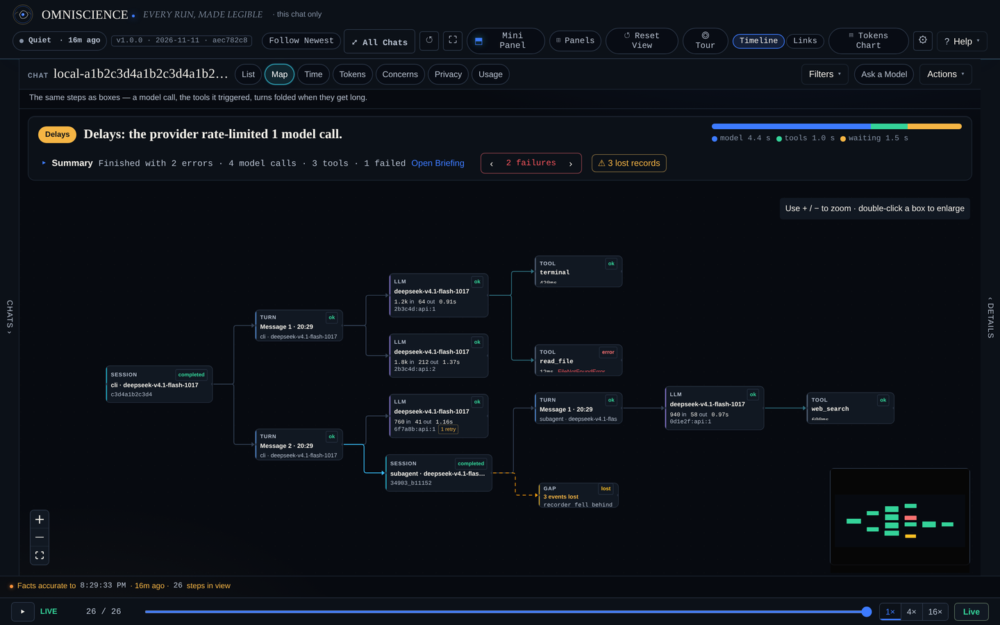
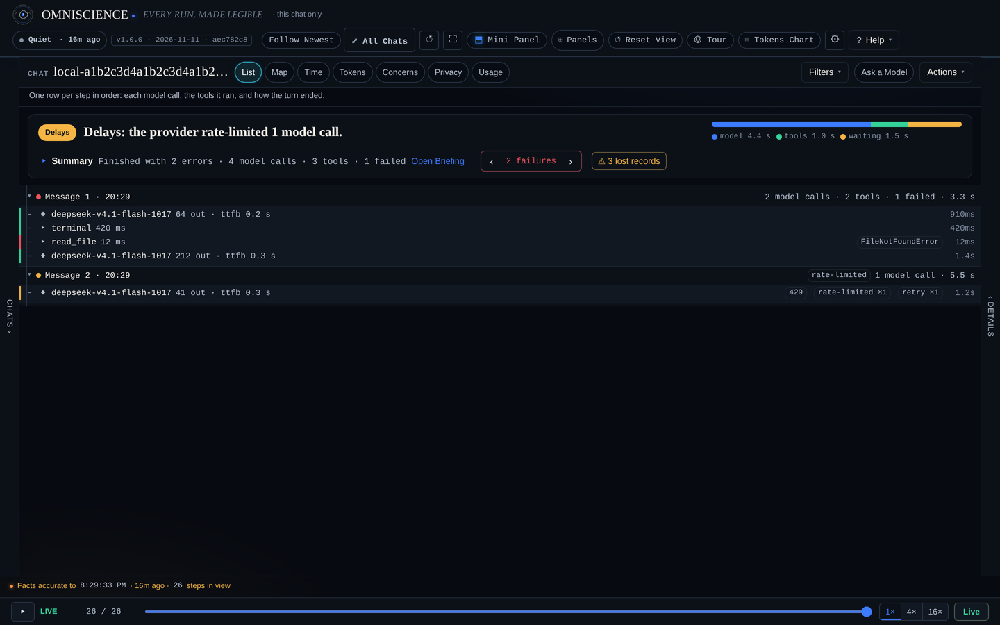
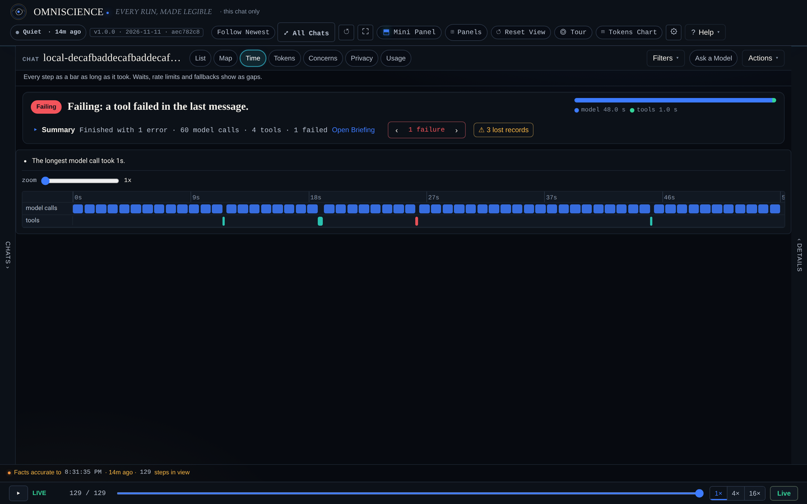

# Usage

> **Applies to:** Omniscience 1.0.0 · written at commit f2109ab
> **Revised:** 2026-11-11 · **Body hash:** 8a4b27ff


A short walkthrough of the viewer and the `/omni` command. For the full reading guide, including
colours, context thresholds and every panel, see [USER-GUIDE](USER-GUIDE.md); for every control on
the screen, see [UI-GUIDE](UI-GUIDE.md).

## Open it

With the plugin enabled, the viewer starts on `http://127.0.0.1:8797` the first time Hermes loads
it. To try it without Hermes:

```bash
PYTHONPATH=viewer_app python3 -m omniscience_viewer --demo
```

The viewer is read-only and loopback-only. The page uses a per-install key that the viewer injects
when it serves the page to this computer; `/omni` and the dashboard page pass the same key.

## The map



The map is the default in the **Simple** preset. A session is the left-most box; each turn is one
message from you; model calls hang off turns; tools hang off the model call that requested them;
helper agents appear as their own session linked to the turn that started them. A `GAP` box means
the recorder dropped events there.

- Folded boxes such as "60 model calls · 4 tools" keep a busy turn readable. Open one when you need
  the detail.
- Green is OK, cyan is running, red is failed, amber is a lost step or warning.
- **Follow Newest** jumps to the chat that is recording now.
- **This Chat Only / All Chats** switches the chat rail between the open chat and every recording.

## The list



**List** is the same recording as one row per step, in order. Each row shows the model, token
counts, time to first byte, duration and any error type. It is the fastest view for "what happened
in what order".

## Time



**Time** draws every model call and tool as a bar as long as it took. Waits, rate limits and
fallbacks show as gaps. Use the zoom control to pull a long run apart.

## Tokens, Usage and Latency

- **Tokens** ranks chats and calls by context size and marks compactions, so you can see which
  conversation is expensive to keep re-sending.
- **Usage** shows what this machine spent: tokens per day, model and provider tables, cache share,
  and Hermes' own cost estimate (labelled as an estimate). Use the period switch for 1 hour, 24
  hours, 7 days, 30 days or all time. Use **By harness** to switch on optional local sources such as
  Claude Code, Codex, opencode, omp, Pi, dsh or DGX Sparks; off means no read at all.
- **Latency** is measured from recorded calls, not by probing: per model and per provider, with rate
  limits, retries, timeouts and compactions seen while that model was in use.

## Triage and explanation

The status band answers three questions before you click anything:

- **Verdict** — OK, Delays, Failing or Running, with where the time went.
- **Summary** — model calls, tools, failures and how the chat ended.
- **Failures** — a stepper that selects each failure on the map.
- **Lost records** — shown when the recorder had to drop events.

**Open Briefing** expands the plain-English summary, each failure with why and what to do, the
activity summary and the timeline. **Warnings** groups patterns worth a look (repeated failures,
loops, stalls, slow calls, token spikes, lost events). **Why** explains a failed run from the
recorded fields only; it says what is missing instead of guessing.

## Replay

Drag the replay bar at the bottom to any step. The graph is rebuilt from the rows up to that point,
with the same layout every time. Nothing is re-run: replay is a pure reduction over stored rows.
The play controls move at 1×, 4× or 16×, and **Live** returns to the newest events.

## Privacy controls

- `/omni off` pauses recording for the current chat; `/omni on` resumes it.
- `/omni privacy` shows what is stored for the chat and whether it is paused.
- `/omni forget` counts what would be deleted; `/omni forget confirm` deletes this chat's recording,
  including helper sessions.
- The viewer's **Privacy** page lists tool runs that touch people or the outside world (browser,
  computer use, wide file sweeps, network calls, MCP servers). A run can be flagged into a
  standalone dossier in `privacy-flags/`.
- **Privacy & security** in Settings controls on-screen alerts. It does not change what is recorded.

## In-chat summary and `/omni`

By default each turn ends with a short summary: what ran, tokens sent and reused, whether the
context is getting expensive, and anything that failed. Change it with:

```text
/omni digest brief | standard | full
/omni digest off
/omni digest on
```

`/omni` alone prints a light triage of the current chat; `/omni full` prints the longer report;
`/omni tokens` prints the usage headline for `today`, `7`, `30` or `all`. When the viewer is running
locally, the reply includes a link to the exact chat or usage period.

## Export and bundles

- **Actions → Export CSV** (or `/api/v1/export/steps.csv`) exports timings, tokens, models and
  statuses. Message text is not stored, so it cannot be exported.
- **Actions → Bundle** builds a redacted JSON problem bundle. You see the exact object in a preview
  before anything is written; identifiers are replaced with synthetic ones and timestamps become
  offsets.

## The dashboard tab

With the plugin enabled, Hermes' dashboard gains an **Omniscience** tab (`/omniscience`). It uses
the dashboard's own login and links to the loopback viewer with the current key. The standalone
viewer works without the dashboard.

## Related

- [INSTALL](INSTALL.md) — install, upgrade and remove.
- [FAQ](FAQ.md) — quick answers.
- [TROUBLESHOOTING](TROUBLESHOOTING.md) — when something does not work.
- [Documentation index](README.md)
