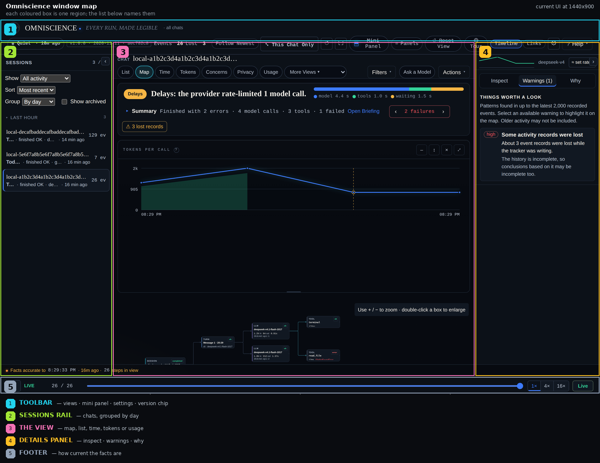

# Omniscience — User Guide

> **Applies to:** Omniscience 1.0.0 · written at commit f2109ab
> **Revised:** 2026-11-11 · **Body hash:** ec557d3f


Omniscience is a Hermes Agent plugin that records metadata about what happens in your chats — which steps ran, when, how big they were, and which models, providers, and tools were involved. It shows this in a local viewer so you can see where time went, what failed, and how tokens were used.

## Quick start

1. In Hermes desktop, open **Settings → Plugins** and switch **Omniscience** on. Hermes keeps plugin desktop parts off until you enable them.
2. After enabling, an **Omniscience** row appears in the left sidebar. It opens on the chat you were in.
3. To open the viewer in a browser, run `PYTHONPATH=viewer python3 -m omniscience_viewer` (add `--static viewer_app/static` when running from a checkout). It serves a local page on `127.0.0.1:8797`.
4. The viewer requires a per-launch key. It is written to `viewer-token` next to the database and is readable only by you.

## Grouping the chat list

The rail groups chats by when they were last active, on by default: **Today**, **Yesterday**, then a
weekday and date, or a month name once the chat is older. Each heading is a fold control with a
count, and folding is remembered per bucket — so a long history can be collapsed to the days you
care about without losing anything.

**Group** beside Sort switches between day, week, month and a flat list. Buckets are computed from
last activity in your own timezone, and the sort you choose still applies inside each bucket.

## Which build am I looking at

The header carries a small chip: `v1.0.0-dev.183 · 2026-11-09 · ec95a4cb` — the build, the date it
was built and the commit it came from. `-dev.N` means pre-release: N commits past the `1.0.0` line,
which has not been tagged yet. It is read from the running viewer, never
compiled in, so it cannot announce a version other than the one answering. It turns amber and adds
`modified` when the installed copy came from a tree with uncommitted changes. Click it to copy the
line for a bug report; hover it for the full commit, the commit date and the build time.

The same line is available two other ways: `omniscience_viewer --version` on the command line, and
`GET /api/v1/version`.

If the chip differs from the line `bash scripts/deploy.sh` printed, the page you are looking at is
not the build you just made — reload it (Ctrl+Shift+R). The page also notices this itself: when the
viewer is updated underneath an open tab, a one-line notice offers a **Reload**.

## How old is a chat

Every row in the chat rail ends with how long since it last recorded anything, in your own clock
and system time: `just now`, `3 min 47 s ago`, `13 min ago`. Hover the row for the exact timestamp.

The badge at the top reads the chat you have open, on one clock:

| Badge | Means |
|---|---|
| **Active now · 2s ago** | an event was recorded in the last 60 seconds |
| **Recent activity · 4m ago** | the last event was between one and five minutes ago |
| **Quiet · 20m ago** | nothing for over five minutes |

Other chats may still be recording while yours is quiet; the badge only ever describes the open
chat. Ages are recomputed locally every few seconds from the same session poll the list already
uses, so they cost no extra requests.

## Reading the context chart and the bars

The chart under a chat plots the context each model call sent, in order. Its vertical axis is
linear while the chat's newest call is in the same range as its peak. Once a compaction has cut the
chat down to a fraction of its old peak, the axis switches to logarithmic and says so above the
chart — a linear axis in that state is set by the old peak and squashes everything since into a
flat line at the bottom, which reads as "nothing is happening" when the truth is "the axis is out
of date". Every gridline is labelled (`1k`, `10k`, `100k`, `517k`), so the line is not exaggerated,
and hover still gives the exact token count.

Point anywhere in the chart and a vertical cursor follows, with the time, the model call number,
the context that call sent and how much of it came from the cache. The horizontal scale is real
clock time (first call, midpoint, last call), so a spike can be matched to when it happened.

In the Tokens view, each row's bar measures the context that call **sent** — the number beside it,
`61k in`. Output tokens are drawn as a thin grey sliver past the end of the bar rather than added
to its length, because what the model wrote is not what it was charged to re-read.

## Reading the context colours

The dots in the chat rail (Tokens view) and the left edge of each chat row say how much context
that chat is carrying, as a share of the point where this machine starts compacting. Six steps,
green through red:

| Colour | Context | What it means |
|---|---|---|
| green | under 100k | plenty of headroom, cheap to re-send |
| lime | 100k–200k | growing, still cheap |
| yellow | 200k–300k | every call is paying for a lot |
| orange | 300k–400k | expensive per call, worth compacting soon |
| red | 400k–470k | compaction starts firing around here |
| blood | over 470k | the context is about to be cut |

The line is a measured number, not a preference: 6,334 recorded calls ran to 517,312 tokens, the
90th percentile was 351,726, and the 14 observed compactions fired with the prompt at 290,556
(median) and 384,373 (75th percentile). The ceiling is one constant, so a model with a different
window moves the line without changing the shape. Hovering a dot or a row states the tokens, the
share of the ceiling, and — where a compaction has happened — the size it peaked at before it.

## Where everything lives



| Region | What is there |
|---|---|
| **1 — toolbar** (top strip) | view switch (list / graph / time / tokens), `More views`, `⬒ mini panel`, `⚙ settings`, and the version chip |
| **2 — sessions rail** (left column) | every chat, grouped by day, with its age, outcome and size |
| **3 — the map** (centre) | whichever view you chose, plus the chart, the cursor and the step list |
| **4 — mini panel** (right column) | the context strip for the open chat at its top, then whatever you asked it to watch |
| **5 — footer** (bottom strip) | "Facts accurate to …" and the replay scrubber |

Regenerate the picture with `python3 scripts/window-map.py <screenshot.png> docs/img/window-map.png`
after a layout change, or it will describe an old window.

## The mini panel, and where the per-chat context strip lives

The **mini panel** is the `⬒ mini panel` chip in the toolbar. It opens a right-hand column beside the
map; in a window narrower than 1100px it slides in as a drawer against the right edge, so it is
reachable at any width. Pressing the chip again closes it.

At the top of that panel sits the **context strip** for the chat you have open, and only that chat:

```
▁▂▃▅▆▇▆▅▇   293,140 now · peak 334,420 · 134,576,164 in · 410,342 out   [≈ set rates]
```

The sparkline is that chat's context per model call. `now` is what the next message pays for,
`peak` is the largest it ever got, `in`/`out` are lifetime billed tokens. The money figure appears
once you click it and give a price per million tokens for input and output; until then it says
`≈ set rates`, because a rate guessed by the tool would be a made-up bill.

## How current is what you are reading

A line at the bottom of the page states the moment the facts on screen are true to:

> **Facts accurate to 17:59:24 · 5s ago · 1,734 steps in view**

Everything recorded up to that time is included; anything after it has not arrived yet. If the
line stops advancing while the agent is working, the recorder or the stream has stalled, and the
line turns amber to say so.

## Latency — how long the models really take, and who refused the call

**More views → latency** is a whole-page report, not a strip: it takes the full width, hides the
chat's own furniture (verdict, failure nav, summary, context chart) and scrolls on its own,
because it describes this machine rather than the conversation you happen to have open.

Two tables, because there are two questions:

- **Providers** — models, calls, worst p95, **rate limited** (429 or a rate-limit reason),
  **retried**, errors, **compactions**, last call. A rate limit belongs to the account, not to a
  model name, and the same model is often served through more than one provider.
- **Models** — the same figures, plus median, p95, slowest, median time to the first word, calls
  over 30 seconds, timeouts and other errors. Sorted worst p95 first, so the top row is the name
  to suspect.

Above them sits a short reading of the numbers: which provider was throttled and how much of its
traffic that was, which model is the slow tail and how far apart its median and first-word times
are (that gap is queuing), what failed beyond rate limits, and how often context was compacted
while a model was in use. A **period** switch (last 24 h / 7 days / 30 days / everything) limits
the whole page.

These are not test requests. Every figure comes from the `duration_s`, `ttfb_s`, `retry_count`
and `llm.error` rows the recorder already wrote, so the page costs nothing and describes exactly
what this machine experienced. An `llm.error` row carries no model of its own, so it is
attributed to the last request in that session — the call it interrupted — and an error with no
request before it is shown under `unknown` rather than dropped.

## Ask a model — a written diagnosis of the whole recording

**Ask a model** (the chip in the view bar) opens one panel: pick any model your Hermes is already
authenticated for, pick a period — last hour, 24 h, 7 days, 30 days or everything — and press
**Write the report**. The panel says where the models come from: your own Hermes accounts, with the
Nous Research portal among them, and nothing is sent to a provider you have not configured. The model reads a digest of the
recording — calls, tokens and cache, per-model and per-provider timings, rate limits and retries,
compaction counts, where the money went — and returns a written diagnosis: what is slow and why,
what failed, whether context growth is the real problem, and five things to change.

The model list is not typed in: it is read from Hermes' own credentials
(`~/.hermes/auth.json`, `config.yaml`, `.env`) and each provider's model list, so every name
offered is one that answers. A provider that will not list its models still gets the ones your
recordings show it serving (marked in the list), so any model you can actually reach is pickable. A provider that cannot be reached is named at the bottom of the
panel instead of silently missing. Any model in the list can be picked.

The picker opens on the cheapest model that has **actually answered calls on this machine** —
a free or low-rate name the recording shows completing, never a cheap one that mostly gets
rate-limited (the free `opencode-zen` route has no successful calls at all, so it is offered but
not suggested). The line under the picker says which model and why. Your choice is remembered.

What it sends: counts, token totals, model and provider names, durations, error reasons and chat
labels. What it never sends: a prompt, a tool argument, a tool result, or a file's contents —
the recorder does not store them, so there is nothing to send. Your keys stay in the viewer;
only the finished text comes back. A report costs one model call, a couple of thousand tokens
each way, to the model you picked.

## When a message stopped: the failure panel

If a run ended badly, the strip above the stage opens on the **newest** failure and answers three
questions in order:

- **What failed** — the tool or the model call, its status, its error type, and the clock time.
- **Why** — read from the recorded rows only: a rate limit is named as the provider throttling you,
  with how many landed in the hour before; a timeout shows how much context that call was carrying;
  a tool failure is compared with the same tool's median in that run, so "it took 30 s against a
  median of 1.1 s" is visible rather than inferred; a refused write says the file may have changed on
  disk; a memory failure points at the character budget.
- **What to do** — two or three concrete actions, in the order that usually helps.

The header and this box read the same rows, so they now agree: a message whose last reply was an
answer with no tool calls is reported as finished (with a count of the failures that happened
earlier) rather than as "stopped without finishing", and only an unanswered request, a tool request
with no tool after it, or a failed last step is called stopped.

Above the list, a separate line answers a different question: **why the run stopped**. An
unanswered model request, a failed last step, a success followed by silence (what a cancel or a
killed process looks like) and a turn that simply ended each read differently, with the age, the
model and the context it was carrying — because "which step failed" and "why did my message never
finish" are not the same question.

Step through the rest with **Earlier / Later**, and **Show this step** jumps to it in the timeline.
The recorder stores no message text, so an answer never quotes one; where the rows cannot support a
cause, the panel says what is missing instead of guessing, and a cancelled tool is not counted as a
failure.

## Every warning comes with what to do

The warnings panel explains each finding in three parts: what happened, what it means, and **what
to do** — the usual cause and the next action, using only recorded facts. Nothing in it claims a
cause the events do not support.

## The views

Under the view switch there is always one line saying what the view you are on is for, and the
**More views** menu names each one with its purpose ("flame — where the time went", "context — how
the prompt grew") rather than making you open six nouns to find out.

**Usage** and **Latency** are account-level pages, so they have no replay transport: the play, 1x and
16x controls belong to a run, and pressing them on a page about the whole machine did nothing. They
also take the full width and hide the chat list, because they describe the machine rather than the
conversation you have open.

- **List** — one row per message. Model-call → tool loops are folded, e.g. "GLM → terminal ×248".
- **Graph** — a graph view of the steps.
- **Time** — bars as long as each step; shows rate limits and fallbacks.
- **Tokens** — a list of chats (when it ran, calls, tool/MCP/skill/outside-call counts, cached
  vs new input, compaction count), then the selected chat in detail: a context line, any compaction,
  the totals, one bar per model call with a clock time, and a table per model. The list's window
  (**Last hour / Today / All**) belongs to **Biggest context now** only: an hour-old chat still has
  a large context but is not what needs attention, so it leaves that ranking. The other rankings —
  most recent, most output, most calls — are questions about history, so they show every chat.
- **Latency** — per-provider and per-model timings, rate limits, retries, timeouts and compactions,
  with a plain reading of what they mean (see *Latency* above).
- **Usage** — what this machine spent, across all chats, over 1 hour / 24 hours / 7 days / 30 days / everything: totals, a day-by-day calendar, tokens per
  day split by model, a model table with measured latency, the cache's share and what it saved, the
  context each call carried and where compaction cut it, and the chats ranked by cost. See
  *Usage — what this machine spent* below.
- **Tools**, **Context**, **Helpers**, **Flame**, **Coverage** — additional views for tool use, context, helper and background calls, and coverage.

### Usage — what this machine spent

### Where the numbers come from

The Usage page reads Hermes by default. Under **Where the numbers come from**, each other agent
(Claude Code, Codex, opencode, omp, pi) has its own switch. Clients that keep no local token counts
are listed too, greyed with the reason — Cursor's usage lives in its dashboard, and Gemini CLI's
chat logs carry no usage block — because a missing row reads as "it forgot Cursor" while a row that
says why is an answer. They can never be switched on: there is nothing on this machine to read. Nothing is read until you turn it on;
turning one off deletes the rows that were imported from it.

Only metadata is read — source, session id, time, model and five token counts. Prompts, replies
and file contents are never stored. The import writes `usage.db` beside the recording's database,
so the recording itself is untouched.

**Enable N detected** turns on every harness found on this machine, one at a time. A first import
of a large history takes a few seconds per hundred thousand calls.

### By harness, hourly, and time spent

- **By harness** — calls, tokens sent, cache read and output per agent, with its share of the
  period. The bar is a proportion of all tokens sent, not a second number to compare.
- **When the calls happened** — model calls by weekday and hour in your own timezone. A dark cell
  is a busy hour.
- **Time spent** — active time counts only gaps under ten minutes, so a chat left open overnight
  is not ten hours of work. Longest run is the honest end-to-end span of one chat; "at once" is
  the peak number of chats with overlapping activity.
 — what this machine spent

**Usage** is a destination, not a default screen: it answers "how much has this box cost me, on
what, and when" rather than "what is this chat doing". Open it from the view switch, or type
`/omni tokens` in a chat — that replies with three lines and a link straight into it.

Pick a period — **Today**, **7 days**, **30 days**, **All** — and the whole page follows:

- **Tokens sent** is the context the model re-read on every call. **Cost** is Hermes' own
  per-session estimate, labelled as such: the recorder keeps token counts, never prices.
- **Cache hit** and **Saved by cache**. The saving is cached tokens priced at the input rate
  instead of the cache rate, using each model's published list price; a model with no published
  rate is left out rather than guessed, and the page says what share was priced.
- **Daily activity** is a real calendar: one cell per day in its own weekday column, shaded by
  tokens. Empty days stay empty so a gap is visible as a gap. Hover for the exact count.
- **Tokens per day, by model** splits each day into the models that sent the most; the long tail
  is folded into one band so the legend stays readable.
- **Models** lists calls, input, cache read, output, p50/p95 latency and time to first word,
  measured from the recorded calls themselves. A healthy median beside a slow p95 is named as a
  slow tail, which usually means queuing.
- **Context economics** shows how big the context was on each call and every compaction, with the
  size before and after — the two things that decide what a chat costs over its life.
- **Chats** ranks conversations by what Hermes says they cost, then by the context they carry now.
  Click a row to open that chat.

A helper agent's spend is rolled into the chat that started it, so a chat's figure is the whole
chat, not just its main thread.

### The context chart under each chat

With **Settings → "Context chart under each chat"** on (the default), the chat you have open shows a
small chart just under its summary:

- the area is how many tokens each model call re-sent, so its height is what every message costs;
- amber dashed lines mark the calls where that number fell — compactions;
- three or four sentences underneath translate it: where it started, what it is now, the biggest single
  jump and where it happened, the average added per message, and how much the last compaction saved.

Hover or focus a point to see that call's prompt, cached and output numbers; click it to open the call.
**⤢** shows the same chart large and centred (Esc closes). Turn the setting off and the map gets the
room back — the chart is a lens, not part of the recording.

### The mini panel

The **⬒ mini panel** button in the header turns the right-hand rail into a 300px watch frame: only
the things you asked to follow, for the chat you have open, beside the graph instead of behind a menu.
Press it again to get the usual panels back.

Press **edit** inside the panel to choose what it watches. "In this chat" lists what actually ran —
tools, MCP servers and skills, busiest first with how often each happened — and one click adds it.
You can also type any tool or skill name, and "Reset to defaults" returns the six that ship. Choices
apply to every chat you open and are remembered on this computer only.

### Two looks

Settings → **Look** switches the whole viewer between **Console** (deep space, cyan and violet, a
faint technical grid; the default) and **Paper** (warm graphite and brass). Same data, same layout,
nothing hidden — it is only a change of face, and Reset view puts it back.

### The turn summary in your chat

Omniscience posts a short summary at the end of each turn, so you never have to open the viewer to
know whether a chat is getting expensive or something failed:

```
⚠ 1 failure: bash
◍ Omniscience · 4 model calls · 12 tool calls (2 MCP) · 1 skill · 2 outside · 1 helper agent · 196 s
248,312 tokens sent per message · 88% reused from cache · 31,044 new on the last call.
Compacting would cut that to about 35,000 per message (86% less).
```

- **What it covers**: what ran, the tokens each message re-sends, how much of that is new, whether
  compacting would pay, and any failure by tool name. Problems are listed first.
- **Three levels**: `/omni detail brief` (what ran and failures only), `standard` (the default: adds
  tokens, cache reuse and the compaction advice), `full` (adds model switches, mid-turn compactions
  and the slowest step).
- **Turning it off**: `/omni digest off` in any chat, or Settings → **In the chat** in the viewer.
  Both write the same setting, and it takes effect on the next turn — no restart. `/omni digest` alone
  tells you where it stands. `OMNISCIENCE_DIGEST=0` in the environment forces it off.
- **Off means off**: no turn summary and no separate cost warning. Other notices (rate limits, provider
  errors, repeated tool failures) are a different switch (`OMNISCIENCE_NOTICES`).
- **No invented money**: every number is a token count the provider actually reported.

### Reading a chat's tokens

Every row in **Tokens → Chats** answers "when did this happen and what did it cost" without opening
the chat: the local time it started and ended, how long it ran, model calls, tool calls (and how many
went over MCP), skill loads, and model calls made outside the conversation (chat titles, approvals,
vision). Hover a row for the full sentence; click it to load that chat.

A **compaction** is a drop in the context sent to the model. Omniscience has no "compaction" event to
read, so it derives one: the chat's own calls are read in order and a prompt that is more than 25%
smaller than the one before it (and at least 1,000 tokens smaller) is marked. Background calls are
skipped, because they send a few hundred tokens and would look like a compaction every time. Each
compaction shows the size before and after, how much context went away, and how far cache reuse fell —
the next call has to process that whole context fresh.

Panels with a **⤢** button open front and centre for close reading, which is what you want on a
laptop; **Esc** closes. **↺ reset view** in the header (and in Settings) puts the panels, zoom,
filters and view back to how they started — it never touches the recording.

### Follow frame

Press **follow** in the header to switch the right frame into a watchlist. Pick what to watch —
failures, rate limits, model switches, compactions, slow steps, new tokens, MCP calls, helper agents,
and any specific tool or skill — and the frame shows only those things for whichever chat you open,
one compact row each with a count, a small history strip, and the newest example. Click a row to jump
to the step. Your choices are remembered on this machine.

At the top you'll see a verdict: **OK / Delays / Failing / Running**, with up to 3 reasons and a **show me** link that jumps to the exact step. Failure counts look like "N failures · showing k of N ◀ ▶".

**Follow newest** jumps to the chat working right now; working chats pulse.

In the desktop sidebar you also get an **all chats** button, a **live pane** that docks a small live view next to the chat, a **⛶ full screen** button, and **⚙ settings**.

## Commands

Type these in a chat:

- `/omni` — short summary: chat size, tokens per call, failures, links.
- `/omni full` — fuller summary.
- `/omni privacy` — what is and isn't recorded.
- `/omni off` — turn recording off.
- `/omni on` — turn recording on.
- `/omni forget` — delete recorded data (asks to confirm).
- `/omni tokens` — what this machine spent in the last 7 days: calls, chats, context and output,
  how much of the context came from the cache and what that saved, Hermes' estimate of the spend,
  the three models carrying the cost with their p95, the three costliest chats, whether compaction
  fired and which model has a slow tail — then a link to the Usage page for the rest.
  `/omni tokens today`, `/omni tokens 30` and `/omni tokens all` pick another period.

## Live notices

While you wait, Omniscience can show one line in the chat for:

- a rate limit (429)
- a fallback (requested X, answered by Y)
- a long wait for the first words (>60 s)
- a provider error
- a tool failing 3 times in a row

The line is edited in place instead of repeated. Turn notices off with `OMNISCIENCE_NOTICES=0`.

## Privacy

**What is kept:** metadata only — which steps happened, when, sizes, model/provider/tool names, names of tool settings, error types/codes, background model calls, skill use, and MCP server names.

**Never kept:** what you or the AI wrote, prompts, tool inputs/outputs, file contents, commands, error text, and API keys.

**Where:** one SQLite file at `~/.hermes/plugin-data/omniscience/events.db`. Nothing is sent anywhere.

**Your controls:** `/omni off` and `/omni on` control recording; `/omni forget` deletes recorded data after confirmation. The viewer only answers this computer and requires the per-launch key.

Chat titles in the viewer come from Hermes and may contain the start of what you typed. Settings can hide them for screen sharing.

## Limits

- Omniscience cannot tell why a model did something, because no content is recorded.
- Cost is only shown when Hermes priced the chat.
- Local models usually show no cost.

## Troubleshooting

- **Viewer offline** → start the viewer (`python -m omniscience_viewer`), and check the key in `viewer-token`.
- **No sidebar row** → enable Omniscience in **Settings → Plugins**.
- **Blank page** → reload the page.
